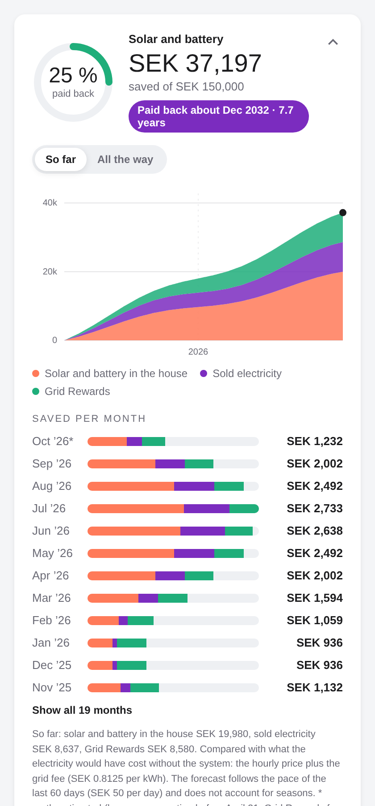

# Solar Payback

**När har solcellerna och batteriet betalat sig?**

Solar Payback är en integration till Home Assistant som räknar ut hur mycket solcellerna och husbatteriet har sparat hittills, hur stor del av köpesumman som är återbetald och när hela anläggningen har betalat sig. Med följer ett kort som visar allt som en graf.

[English instructions](README.md)



Det fungerar med alla märken av växelriktare och batterier och alla elbolag, så länge Home Assistant har energistatistiken. Har du Tibber hittar den allt själv.

## Innehåll

- [Så fungerar det](#så-fungerar-det)
- [Det här behövs](#det-här-behövs)
- [Hur långt bak går det?](#hur-långt-bak-går-det)
- [Steg 1: Installera](#steg-1-installera)
- [Steg 2: Kontrollera din eldata](#steg-2-kontrollera-din-eldata)
- [Steg 3: Hitta husets förbrukning](#steg-3-hitta-husets-förbrukning-för-din-växelriktare-eller-ditt-batteri)
- [Steg 4: Lägg till integrationen](#steg-4-lägg-till-integrationen)
- [Steg 5: Ange månadsersättningen](#steg-5-ange-månadsersättningen-valfritt)
- [Steg 6: Lägg till kortet](#steg-6-lägg-till-kortet)
- [Sensorer](#sensorer)
- [Frågor och begränsningar](#frågor-och-begränsningar)

## Så fungerar det

En gång i timmen läser integrationen Home Assistants långtidsstatistik från startdatumet och värderar varje timme:

| Del | Så värderas den |
|---|---|
| **Sol och batteri i huset** | El som huset använde men inte köpte från nätet (den kom från solcellerna eller batteriet). Den är värd vad den hade kostat: timpriset plus nätavgiften du slipper. |
| **Såld el** | Det elbolaget betalade för elen du sålde, plus eventuell ersättning från nätbolaget per såld kWh. |
| **Månadsersättning** | Pengar en tjänst betalar dig varje månad, t.ex. Tibbers Grid Rewards för att batteriet hjälper elnätet. Du anger den en gång i månaden. |

Allt summeras per dag. Prognosen utgår från att du fortsätter spara i samma takt som de senaste 60 dagarna (antalet dagar går att ändra).

Kalkylen använder *husets förbrukning − köpt el*, så den räknar både solel som används direkt och el som gått via batteriet. Laddar du batteriet från nätet på natten och använder det på kvällen blir det också rätt: den köpta elen dras av till priset den timme den köptes.

## Det här behövs

Allt måste vara sensorer eller statistik med **långtidsstatistik** i Home Assistant (allt som syns i Energi-panelen har det).

| Data | Krävs? | Vanlig källa |
|---|---|---|
| El köpt från nätet (kWh) | Ja | Tibber, elmätaren (HAN-porten) eller växelriktarens nätmätare |
| Kostnad för köpt el | En av dessa två | Tibber, eller kostnadssensorn som Energi-panelen skapar |
| Elpris per kWh | | Nord Pool, Tibbers prissensor, ENTSO-e |
| El såld till nätet (kWh) | Om du säljer | Tibber, elmätaren eller växelriktaren |
| Ersättning för såld el | Nej | Tibber, eller ersättningssensorn som Energi-panelen skapar. Saknas den värderas såld el till elpriset. |
| **Husets förbrukning (kWh)** | Ja | Växelriktaren eller batterisystemet. Se [Steg 3](#steg-3-hitta-husets-förbrukning-för-din-växelriktare-eller-ditt-batteri). |
| Nätavgift per köpt kWh | Rekommenderas | Nätbolagets faktura (anges som en siffra) |
| Månadsersättning | Nej | Elbolagets app eller faktura (anges varje månad) |

## Hur långt bak går det?

Home Assistant sparar långtidsstatistik för alltid, så inget försvinner när det väl finns där. Hur långt bak du kommer beror på när varje källa började spelas in:

- **Tibber** fyller på historiken bakåt i tiden själv, ofta långt innan du lade till Tibber i Home Assistant. Köpt och såld el och kostnad brukar vara kompletta från första dagen.
- **Växelriktarens förbrukning** finns bara från dagen du lade till växelriktarens integration i Home Assistant. Den går inte att hämta i efterhand.
- **Dagar innan husets förbrukning fanns** uppskattas från snittet av de första 30 dagarna med data. De månaderna markeras med * på kortet. Ju längre anläggningen har gått, desto mindre spelar uppskattningen roll.
- **Månadsersättningar** finns inte i något API vi känner till. Du anger dem för hand från appen eller fakturorna, och du kan ange gamla månader också, så långt bak du har siffrorna. Månader du hoppar över uppskattas från den senaste månaden du angett.

Du behöver inte ge tillgång till gamla fakturor. Det enda du slår upp för hand är månadsersättningen.

## Steg 1: Installera

Du behöver ha [HACS](https://hacs.xyz) installerat.

1. Öppna **HACS** i Home Assistant.
2. Tryck på de tre prickarna uppe till höger och välj **Custom repositories**.
3. Klistra in adressen till det här repot, välj typ **Integration** och tryck **Add**.
4. Sök efter **Solar Payback** i HACS, öppna den och tryck **Download**.
5. Starta om Home Assistant (**Inställningar → System → Starta om**).

Kortet följer med och laddas automatiskt. Du behöver inte installera det separat.

## Steg 2: Kontrollera din eldata

### Om du har Tibber

Inget att göra. När du lägger till Solar Payback hittar den Tibbers statistik för köpt el, kostnad, såld el och ersättning själv.

### Andra elbolag

1. Gå till **Inställningar → Instrumentpaneler → Energi** och kontrollera att **Nätförbrukning** (och **Retur till nätet** om du säljer) är inställda.
2. Välj där hur kostnaden räknas: **Använd en entitet med aktuellt pris** (t.ex. Nord Pool) eller ett fast pris. Home Assistant skapar då statistik för kostnaden för köpt el och ersättningen för såld el. Det är dem du väljer i steg 4.
3. Vill du inte använda Energi-panelen kan du installera en prisintegration som **Nord Pool** (inbyggd) och välja dess prissensor i steg 4.

## Steg 3: Hitta husets förbrukning för din växelriktare eller ditt batteri

Husets förbrukning är **allt huset använder**, oavsett om det kommer från solcellerna, batteriet eller nätet. Det måste vara en energisensor i **kWh som räknar uppåt** (inte effekt i W).

### Så letar du

1. Gå till **Inställningar → Enheter och tjänster** och öppna integrationen för din växelriktare eller ditt batteri.
2. Leta efter en energisensor med ett namn som *load*, *consumption*, *house consumption*, *förbrukning* eller *total load*. Den ska ha enheten kWh och ett värde som bara går uppåt (en total sedan start eller en dagssumma som nollställs vid midnatt fungerar båda).
3. Kontrollera att den har statistik: öppna sensorn och titta på grafen. Ser du staplar eller en jämn linje över flera dagar fungerar det.

### Vanliga märken

Namnen skiljer sig mellan integrationer och versioner, så se det här som tips på vad du ska leta efter.

| Märke | Integration | Leta efter |
|---|---|---|
| **SAJ** (H1, H2, HS2, HS3) | SAJ Modbus-integrationer | En sensor för *total load* eller *load energy* i kWh. |
| **Huawei** (SUN2000 + LUNA2000) | Huawei Solar (HACS) | Oftast ingen direkt energisensor för huset. Använd formeln nedan med elmätarens köpt/såld, växelriktarens totala produktion och batteriets laddning/urladdning. |
| **Tesla Powerwall** | Powerwall (inbyggd) | Energisensorn **Load import**. |
| **SolarEdge** | SolarEdge (inbyggd) eller SolarEdge Modbus Multi | En energisensor för *consumed* eller *consumption* om du har en SolarEdge-mätare, annars formeln nedan. |
| **Fronius** | Fronius (inbyggd) | *Power load* är effekt (W), oftast negativ. Gör den positiv med en mall och gör om den till kWh med en integralhjälpare, se nedan. |
| **Victron** (Cerbo GX, MultiPlus) | Victron GX Modbus / MQTT | Effekten *AC consumption* (W). Gör om den till kWh med en integralhjälpare. |
| **Enphase** | Enphase Envoy (inbyggd) | *Lifetime energy consumption*, om förbrukningsmätare (CT) är installerade. |
| **Sungrow** | Sungrow Modbus (HACS) | En sensor för *total load* eller *load energy consumption*. |
| **GoodWe** | GoodWe (inbyggd) | En energisensor för husets eller lastens förbrukning. Finns bara effekten *House consumption* (W), använd en integralhjälpare. |
| **Deye, Sunsynk, Solis, Growatt** | Solarman, Sunsynk, Growatt med flera | En sensor för *total load consumption* eller *load energy*. |

Är du osäker, jämför en dags värde med växelriktarens egen app. De ska ligga nära varandra.

### Om det inte finns någon förbrukningssensor: skapa en

**Alternativ A: du har en effektsensor (W) för huset.** Gör om den till energi med en integralhjälpare:

1. Gå till **Inställningar → Enheter och tjänster → Hjälpare → Skapa hjälpare → Integral-sensor**.
2. Ge den ett namn, t.ex. *Husets förbrukning*.
3. Indatasensor: husets effektsensor.
4. Integrationsmetod: **Vänster**. Metriskt prefix: **k (kilo)**. Tidsenhet: **Timmar**.
5. Tryck **Skicka**. Nu har du en kWh-sensor med statistik.

Är effektsensorn negativ (som hos Fronius), skapa först en mallsensor (**Hjälpare → Skapa hjälpare → Mall → Mallsensor**) med tillståndet `{{ states('sensor.din_power_load') | float(0) | abs }}`, enhet **W**, enhetsklass **Effekt**, tillståndsklass **Mätning**, och använd den i stället.

**Alternativ B: räkna fram den från de andra energisensorerna.** Huset använder det som kommer in minus det som går ut:

```
huset = köpt från nätet + solproduktion + batteriets urladdning − såld till nätet − batteriets laddning
```

För hybridväxelriktare där växelriktarens AC-produktion redan räknar med batteriet (vanligt hos Huawei, SAJ, GoodWe, Sungrow och Deye) räcker ofta:

```
huset = köpt från nätet + växelriktarens AC-produktion − såld till nätet
```

Skapa den som en mallsensor (**Hjälpare → Skapa hjälpare → Mall → Mallsensor**):

- Tillstånd, till exempel: `{{ states('sensor.kopt_total') | float(0) + states('sensor.sol_total') | float(0) + states('sensor.batteri_urladdning_total') | float(0) - states('sensor.sald_total') | float(0) - states('sensor.batteri_laddning_total') | float(0) }}`
- Enhet **kWh**, enhetsklass **Energi**, tillståndsklass **Totalt ökande**.

Använd totaler sedan start (inte dagssummor) i formeln, så att resultatet aldrig sjunker vid midnatt.

**Kom ihåg:** en sensor du skapar nu har bara statistik från i dag. Dagarna innan uppskattas, se [Hur långt bak går det?](#hur-långt-bak-går-det)

## Steg 4: Lägg till integrationen

1. Gå till **Inställningar → Enheter och tjänster → Lägg till integration** och sök efter **Solar Payback**.
2. **Din solcellsanläggning**
   - *Namn*: vad du vill, t.ex. *Sol*.
   - *Köpesumma*: det du faktiskt betalade, efter grönt avdrag eller bidrag.
   - *Startdatum*: dagen anläggningen startade, t.ex. första dagen du sålde el.
3. **Köpt och såld el**: välj **Tibber** om det erbjuds, annars statistiken från steg 2.
4. **Husets förbrukning**: välj sensorn från steg 3. Med Tibber kan du också välja en elprissensor som reserv för timmar där Tibber saknar kostnad.
5. **Nätavgifter och inställningar**
   - *Nätavgift per köpt kWh*: titta på nätbolagets faktura. Lägg ihop elöverföring och energiskatt per kWh, och räkna med moms. Exempel: överföring 25 öre + energiskatt 40 öre exkl. moms = 0,65 × 1,25 = **0,8125** kr per kWh. Det är vad du slipper betala för varje kWh du inte köper. Den fasta abonnemangsavgiften ändras inte och räknas inte med.
   - *Nätersättning per såld kWh*: det nätbolaget betalar dig per såld kWh (ofta några öre, utan moms). 0 om ingen.
   - *Elbolagets påslag per kWh*: används bara när timkostnaden saknas och spotpriset används i stället. Exklusive moms.
   - *Momsfaktor*: 1,25 för 25 % moms.
   - *Prognos baserad på senaste dagarna*: 60 är en bra start. En längre period ger en lugnare prognos.
   - *Jag får en månadsersättning*: slå på om en tjänst betalar dig varje månad, t.ex. Tibbers Grid Rewards. Låt vara av om du inte får någon sådan ersättning: kortet visar då bara sol, batteri och såld el, och ingen påminnelse kommer varje månad.
   - *Namn på månadsersättningen*: visas på kortet, t.ex. *Grid Rewards*.
   - *Månadsersättningen anges inklusive moms*: låt vara av om fakturan visar ersättningen exklusive moms. Då läggs momsen den sparar till.
6. Tryck **Skicka**. Sensorerna dyker upp efter några sekunder.

Allt utom datakällan kan ändras senare under **Inställningar → Enheter och tjänster → Solar Payback → Konfigurera**.

## Steg 5: Ange månadsersättningen (valfritt)

Hoppa över det här steget om du inte får någon månadsersättning. Annars slår du på *Jag får en månadsersättning* i steg 4 (eller senare under **Konfigurera**).

Får du betalt för att batteriet hjälper elnätet (t.ex. Tibbers Grid Rewards, eller ersättning för stödtjänster/FCR från en annan aktör), ange beloppet en gång i månaden:

1. Gå till **Utvecklarverktyg → Åtgärder**.
2. Välj **Solar Payback: Ange månadsersättning**.
3. Fyll i *Månad* (t.ex. `2026-09`) och *Belopp* (som ett positivt tal).
4. Tryck **Utför åtgärd**.

**Enklast:** öppna kortet, tryck **+ Lägg till Grid Rewards**, välj månad, skriv beloppet och tryck **Spara**. När förra månaden saknas visar kortet en påminnelse överst som öppnar samma ruta.

Eller i YAML:

```yaml
action: solar_payback.set_monthly_reward
data:
  month: "2026-09"
  amount: 450.00
```

**Tips för Tibber:** I Tibber-appen under *Rewards* delas Grid Rewards upp mellan husbatteri och elbil. Vill du bara räkna det batteriet tjänar, använd batteriets belopp. Fakturan visar bara totalen.

**Påminnelse:** den binära sensorn *Månadsersättning saknas* slås på när förra månaden saknar värde. En automation som påminner dig den 5:e varje månad (byt entitets-id mot ditt):

```yaml
alias: Påminn om månadsersättning
triggers:
  - trigger: time
    at: "09:00:00"
conditions:
  - condition: template
    value_template: "{{ now().day == 5 }}"
  - condition: state
    entity_id: binary_sensor.sol_manadsersattning_saknas
    state: "on"
actions:
  - action: notify.notify
    data:
      message: "Lägg in förra månadens Grid Rewards i Solar Payback."
```

För att ta bort en månad, använd **Solar Payback: Ta bort månadsersättning**.

## Steg 6: Lägg till kortet

1. Öppna en instrumentpanel, tryck **Redigera** och **Lägg till kort**.
2. Sök efter **Solar Payback**.
3. Välj sensorn *Sparat hittills*.

Eller i YAML (byt entitets-id mot ditt):

```yaml
type: custom:solar-payback-card
entity: sensor.sol_sparat_hittills
```

| Inställning | Standard | Beskrivning |
|---|---|---|
| `entity` | | Sensorn *Sparat hittills* (krävs) |
| `title` | *Solceller och batteri* | Rubrik på kortet |
| `collapsed` | `true` | Börja ihopfällt. Tryck på kortets topp för att visa grafen. |

Kortet följer ditt tema och visas på svenska eller engelska beroende på ditt språk.

## Sensorer

| Sensor | Beskrivning |
|---|---|
| Sparat hittills | Totalt sparat sedan startdatumet. Attributen innehåller datan till kortet. |
| Återbetalt | Andel av köpesumman som är intjänad (%) |
| Kvar att tjäna in | Belopp kvar till köpesumman |
| Återbetalningsdatum | Beräknat datum när anläggningen har betalat sig |
| Återbetalningstid | År från start till återbetalningsdatumet |
| Sparat per dag | Snitt för de senaste dagarna (prognosens takt) |
| Sparat denna månad | Sparat hittills i månaden |
| Månadsersättning totalt | Summan av alla månadsersättningar (bara med månadsersättning påslagen) |
| Månadsersättning saknas | På när förra månaden saknar ersättning (bara med månadsersättning påslagen) |

## Frågor och begränsningar

- **Prognosen känner inte till årstider.** På sommaren ser det snabbare ut, på vintern långsammare. En längre prognosperiod (t.ex. 365 dagar när du har ett års data) jämnar ut det.
- **Skattereduktion och andra bidrag** per såld kWh kan räknas in i nätersättningen om de gäller dig.
- **Fasta avgifter** (abonnemang, månadsavgifter) räknas inte med eftersom de inte ändras av anläggningen.
- **Flera anläggningar eller hus?** Lägg till integrationen en gång per anläggning.
- **Integritet:** allt räknas lokalt i din Home Assistant. Inget skickas någonstans.

## Licens

[MIT](LICENSE)
